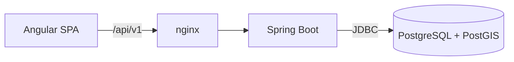

# CivicPulse

> Intelligent urban issue reporting and management platform.

Citizens report problems in their city (potholes, broken street lights, illegal
dumping, blocked ramps) and follow them until they are fixed. City teams triage,
deduplicate, prioritize and resolve the reports.


## Run it

```bash
docker compose up --build
```

Then open <http://localhost:8080>. No configuration is needed; see
[local setup](docs/development/local-setup.md) for working on the backend or
frontend directly.

## Architecture

A modular monolith: one Spring Boot backend, an Angular SPA served by nginx, and
PostgreSQL with PostGIS.



- [Architecture overview](docs/architecture/overview.md)
- [ADR 001: Modular monolith](docs/adr/001-modular-monolith.md)
- [ADR 002: PostgreSQL and PostGIS](docs/adr/002-postgresql-postgis.md)
- [API conventions and error format](docs/api/README.md)
- [Database conventions](docs/database/README.md)

## Tech stack

| Area | Technology |
| --- | --- |
| Backend | Java 21, Spring Boot 3.5, Spring Modulith, Flyway |
| Database | PostgreSQL 17, PostGIS, pg_trgm |
| Frontend | Angular 22, TypeScript, Transloco |
| Tests | JUnit 5, Testcontainers, Vitest |
| Delivery | Docker, Docker Compose, GitHub Actions |

## Engineering highlights

- Module boundaries are checked by a test (`ModularityTests`), so a module
  reaching into another module's internals fails the build.
- Every API error, including unknown paths and errors raised outside
  controllers, uses one JSON format with a `traceId`. Stack traces and exception
  messages never reach the client.
- Each response has an `X-Request-Id` header; the same id appears in the logs.
- Integration tests run against a real PostGIS container and migrate an empty
  database on every build.
- nginx sends a strict Content Security Policy, and actuator endpoints run on a
  separate port that nginx does not expose.
- Accessibility basics from the start: skip link, focus moved on navigation,
  page titles per route, visible focus, reduced motion respected.

## Roadmap

- [x] Project setup, CI, Docker
- [ ] Authentication, users and roles
- [ ] Reports and their lifecycle
- [ ] Geospatial search
- [ ] Map and report form for citizens
- [ ] Operator and moderator dashboards
- [ ] Photo uploads
- [ ] Duplicate detection
- [ ] Priority score and SLA escalation
- [ ] Notifications and live updates
- [ ] AI-assisted classification
- [ ] Observability, performance tests, end-to-end tests

## Development

```bash
cd backend && mvn verify            # unit + integration tests (Docker required)
cd frontend && npm ci && npm test   # frontend tests
```

See [CONTRIBUTING.md](CONTRIBUTING.md) and [SECURITY.md](SECURITY.md).

## License

[MIT](LICENSE)
