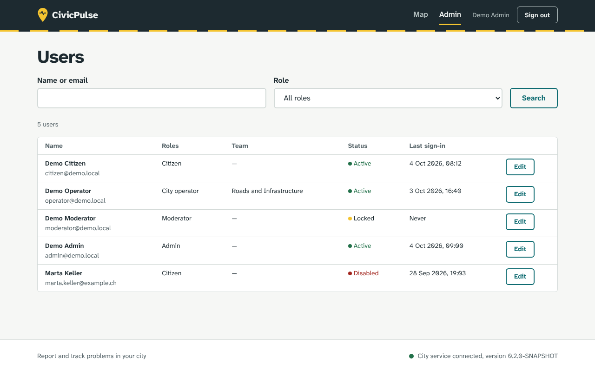
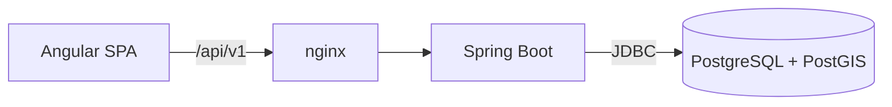

# CivicPulse

> Intelligent urban issue reporting and management platform.

Citizens report problems in their city (potholes, broken street lights, illegal
dumping, blocked ramps) and follow them until they are fixed. City teams triage,
deduplicate, prioritize and resolve the reports.



## Run it

```bash
docker compose up --build
```

Then open <http://localhost:8080>. No configuration is needed; see
[local setup](docs/development/local-setup.md) for working on the backend or
frontend directly.

### Demo accounts

The local setup runs with the `demo` profile, which creates these accounts.
They are for local use only.

| Email | Role | Password |
| --- | --- | --- |
| `citizen@demo.local` | Citizen | `civicpulse-demo` |
| `moderator@demo.local` | Moderator | `civicpulse-demo` |
| `operator@demo.local` | City operator (Roads and Infrastructure) | `civicpulse-demo` |
| `admin@demo.local` | Admin | `civicpulse-demo` |

## Architecture

A modular monolith: one Spring Boot backend, an Angular SPA served by nginx, and
PostgreSQL with PostGIS.



- [Architecture overview](docs/architecture/overview.md)
- [ADR 001: Modular monolith](docs/adr/001-modular-monolith.md)
- [ADR 002: PostgreSQL and PostGIS](docs/adr/002-postgresql-postgis.md)
- [ADR 003: Authentication](docs/adr/003-authentication.md)
- [API conventions and error format](docs/api/README.md)
- [Database conventions](docs/database/README.md)

## Tech stack

| Area | Technology |
| --- | --- |
| Backend | Java 21, Spring Boot 3.5, Spring Security, Spring Modulith, Flyway |
| Database | PostgreSQL 17, PostGIS, pg_trgm |
| Frontend | Angular 22, TypeScript, Transloco |
| Tests | JUnit 5, Testcontainers, Vitest |
| Delivery | Docker, Docker Compose, GitHub Actions |

## Engineering highlights

- JWT access tokens (15 min) kept in memory, refresh tokens in an HttpOnly cookie
  and rotated on every refresh. A reused refresh token revokes the session. See
  [ADR 003](docs/adr/003-authentication.md).
- Roles checked on the backend by URL rules and `@PreAuthorize`; integration
  tests cover each role on the admin endpoints.
- Lockout after 5 failed logins, rate limiting per IP.
- Append-only audit log (a trigger blocks UPDATE/DELETE), written in the same
  transaction as the change.
- `ModularityTests` fails the build if a module uses another module's internals.
- One JSON error format with a `traceId` for every error.
- `X-Request-Id` on every response and in the logs.
- Integration tests run against PostGIS in Testcontainers.
- CSP and other security headers in nginx; actuator on a separate port.
- Basic accessibility: skip link, focus handling on navigation, page titles.

## Roadmap

- [x] Project setup, CI, Docker
- [x] Authentication, users, roles and audit log
- [ ] Reports and their lifecycle
- [ ] Geospatial search
- [ ] Map and report form for citizens
- [ ] Operator and moderator dashboards
- [ ] Photo uploads
- [ ] Duplicate detection
- [ ] Priority score and SLA escalation
- [ ] Notifications and live updates
- [ ] AI-assisted classification
- [ ] Observability, performance tests, end-to-end tests

## Development

```bash
cd backend && mvn verify            # unit + integration tests (Docker required)
cd frontend && npm ci && npm test   # frontend tests
```

See [CONTRIBUTING.md](CONTRIBUTING.md) and [SECURITY.md](SECURITY.md).

## License

[MIT](LICENSE)
