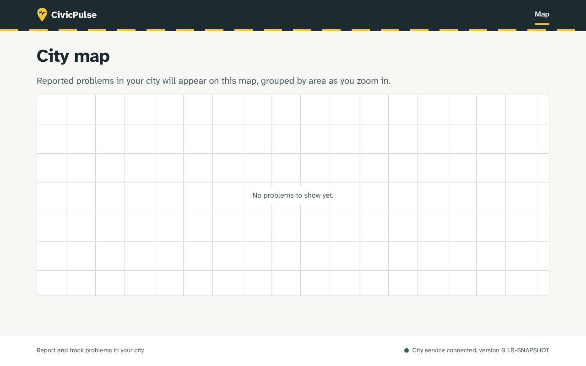
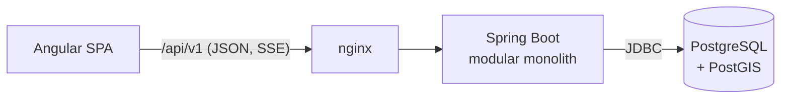

# CivicPulse

> Intelligent urban issue reporting and management platform.

Citizens report problems in their city (potholes, broken street lights,
illegal dumping, blocked ramps) and follow them until they are fixed. City
teams triage, deduplicate, prioritize and resolve them, with every automated
judgement explained and every high-impact decision left to a person.

**Status:** Phase 1 of 16 complete: architecture, repository and delivery
pipeline. The business features listed below are designed and land phase by
phase; see the [roadmap](#roadmap).



## Quick start

```bash
docker compose up --build
```

Open <http://localhost:8080>. No configuration is needed; see
[local setup](docs/development/local-setup.md) for development workflows and
[`.env.example`](.env.example) for every setting.

## Architecture

A modular monolith: one Spring Boot backend, one Angular SPA behind nginx, and
PostgreSQL with PostGIS. Module boundaries are verified by a test, not by
convention.



- [Architecture overview](docs/architecture/overview.md)
- [ADR-001: modular monolith](docs/adr/001-modular-monolith.md)
- [ADR-002: PostgreSQL + PostGIS](docs/adr/002-postgresql-postgis.md)
- [API conventions and error model](docs/api/README.md)
- [Database conventions](docs/database/README.md)

## Technology

| Layer | Choice | Why |
| --- | --- | --- |
| Backend | Java 21, Spring Boot 3.5, Spring Modulith | modules with verified boundaries in one deployable |
| Data | PostgreSQL 17, PostGIS, pg_trgm, Flyway | spatial queries on indexes; text similarity; reproducible schema |
| Frontend | Angular 22, TypeScript, Transloco | standalone components, signals; no hard-coded UI text |
| Testing | JUnit 5, Testcontainers, Vitest | integration tests against real PostGIS, never H2 |
| Delivery | Docker, Compose, GitHub Actions | one-command local stack; every PR builds, tests and packages |

## Engineering highlights (so far)

- **Verified module boundaries.** `ModularityTests` fails the build if a module
  reaches into another's internals ([ADR-001](docs/adr/001-modular-monolith.md)).
- **One error contract.** Every failure, including 404s from unknown paths and
  errors raised outside controllers, returns the same JSON shape with a
  `traceId`; internal details never leave the server. Covered by contract tests.
- **Request correlation.** Every response carries `X-Request-Id`; the same id
  is in structured logs and error bodies.
- **Real database in tests.** Integration tests migrate an empty PostGIS
  database from V1 on every build.
- **Strict browser security.** nginx sends a CSP with `script-src 'self'`;
  actuator runs on a port nginx never proxies.
- **Accessibility from the first screen.** Skip link, focus management on
  navigation, translated page titles, visible focus, reduced-motion support,
  and a typeface designed for low-vision readability.

## Roadmap

| Phase | Scope | State |
| --- | --- | --- |
| 1 | Architecture, repository, CI, Docker | done |
| 2 | Authentication, users, roles, audit | next |
| 3 | Report domain and lifecycle state machine | planned |
| 4 | Geospatial search (nearby, bounding box, clustering) | planned |
| 5 | Citizen experience: map and report wizard | planned |
| 6 | Operator and moderator dashboards | planned |
| 7 | Photo upload and storage abstraction | planned |
| 8 | Duplicate detection | planned |
| 9 | Explainable priority engine and SLA escalation | planned |
| 10 | Notifications and real-time updates | planned |
| 11 | AI-assisted classification | planned |
| 12–16 | E2E testing, observability, CI hardening, performance, documentation | planned |

## Development

```bash
cd backend && mvn verify            # unit + integration tests (needs Docker)
cd frontend && npm ci && npm test   # frontend unit tests
```

See [CONTRIBUTING.md](CONTRIBUTING.md) for conventions and
[SECURITY.md](SECURITY.md) for the security model.

## License

[MIT](LICENSE)
