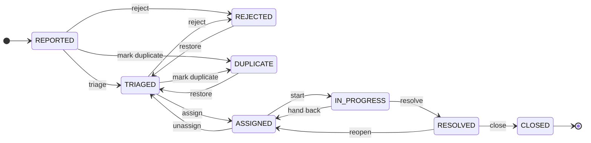

# ADR 004: Report lifecycle as an action table

Status: accepted
Date: 2026-10-04

## Context

A report goes through nine statuses. Who may change it depends on the role
(moderator, operator), on the report (its reporter, the team it is assigned to)
and sometimes on time (a reporter can reopen only for a while). Some changes
need extra input, like a reason or a team. A free `PATCH status` would spread
these rules over controllers and the frontend.

## Decision

Status changes happen only through named actions. Each action has a set of
statuses it starts from, a target status and who may perform it. The table lives
in `ReportAction`:

| Action | From | To | Who |
| --- | --- | --- | --- |
| `TRIAGE` | REPORTED | TRIAGED | moderator, operator |
| `REJECT` | REPORTED, TRIAGED | REJECTED | moderator |
| `MARK_DUPLICATE` | REPORTED, TRIAGED | DUPLICATE | moderator, operator |
| `REQUEST_INFORMATION` | REPORTED, TRIAGED, ASSIGNED, IN_PROGRESS | WAITING_FOR_INFORMATION | moderator, operator |
| `PROVIDE_INFORMATION` | WAITING_FOR_INFORMATION | previous status | reporter |
| `RESUME` | WAITING_FOR_INFORMATION | previous status | moderator, operator |
| `ASSIGN` | TRIAGED | ASSIGNED | operator |
| `UNASSIGN` | ASSIGNED | TRIAGED | operator |
| `START` | ASSIGNED | IN_PROGRESS | operator in the assigned team |
| `HAND_BACK` | IN_PROGRESS | ASSIGNED | operator in the assigned team |
| `RESOLVE` | IN_PROGRESS | RESOLVED | operator in the assigned team |
| `REOPEN` | RESOLVED | ASSIGNED | reporter, within 14 days |
| `CLOSE` | RESOLVED | CLOSED | operator, or the system after 14 days |
| `RESTORE` | REJECTED, DUPLICATE | TRIAGED | moderator |

`WAITING_FOR_INFORMATION` is left out of the diagram: it can be entered from
REPORTED, TRIAGED, ASSIGNED and IN_PROGRESS and returns to where it came from.

- `Report` has one method per action. Each checks the rule and changes the
  fields that belong to it (for example `UNASSIGN` clears the team).
- The order of checks is: role (403), current status (409
  `INVALID_STATUS_TRANSITION`), team or reporter (403), time limit (409).
- Every action is its own endpoint, `POST /api/v1/reports/{id}/{action}`, with
  its own request body and validation.
- Roles and team are read from the database on every report request, not from
  the token, so a role or team change applies at once. A moderator who loses
  the role stops seeing internal notes right away.
- Admins have no report actions. An admin who also works on reports needs the
  operator or moderator role as well.
- `GET /api/v1/reports/{id}/actions` returns the actions the current user may
  run now, so the frontend does not repeat the rules.
- `ReportLifecycleTest` checks all 81 (from, to) pairs against
  `report-lifecycle.csv`, which is the table above.

Every change writes a public `STATUS_CHANGED` entry to `report_events`. Things
meant only for staff (unassign reason, hand-back note, restore reason, the team
and assignee) go into a separate `NOTE` entry with `INTERNAL` visibility, so the
public entry never has to be filtered field by field.

Concurrent edits use optimistic locking. `GET` returns the version as `ETag`,
commands need `If-Match`. A missing header is 428, an old version 412.

The design document had 7 days for auto-close and 14 days for reopening. These
don't fit together, so both are 14 days: the reporter can reopen until the
report is closed.

## Alternatives

- Spring Statemachine: a lot of machinery for 14 transitions, and the guards
  need the report and the user anyway.
- A status field with `PATCH`: simple, but every client would need to know the
  rules, and required input (reason, team) can't be validated per change.
- A transition table in the database: admins could change it, but the code
  around each action (clearing the team, remembering the previous status) would
  still be needed.

## Consequences

- A new transition means a new enum constant, a method on `Report`, an
  endpoint and a line in the CSV; the matrix test fails if the CSV is not
  updated.
- Merging duplicates is only a status change for now. Moving confirmations and
  photos to the original comes with duplicate detection.
- The auto-close job closes up to 100 reports per run. With several instances
  two runs can pick the same report; one of them fails on the version check and
  rolls back.
