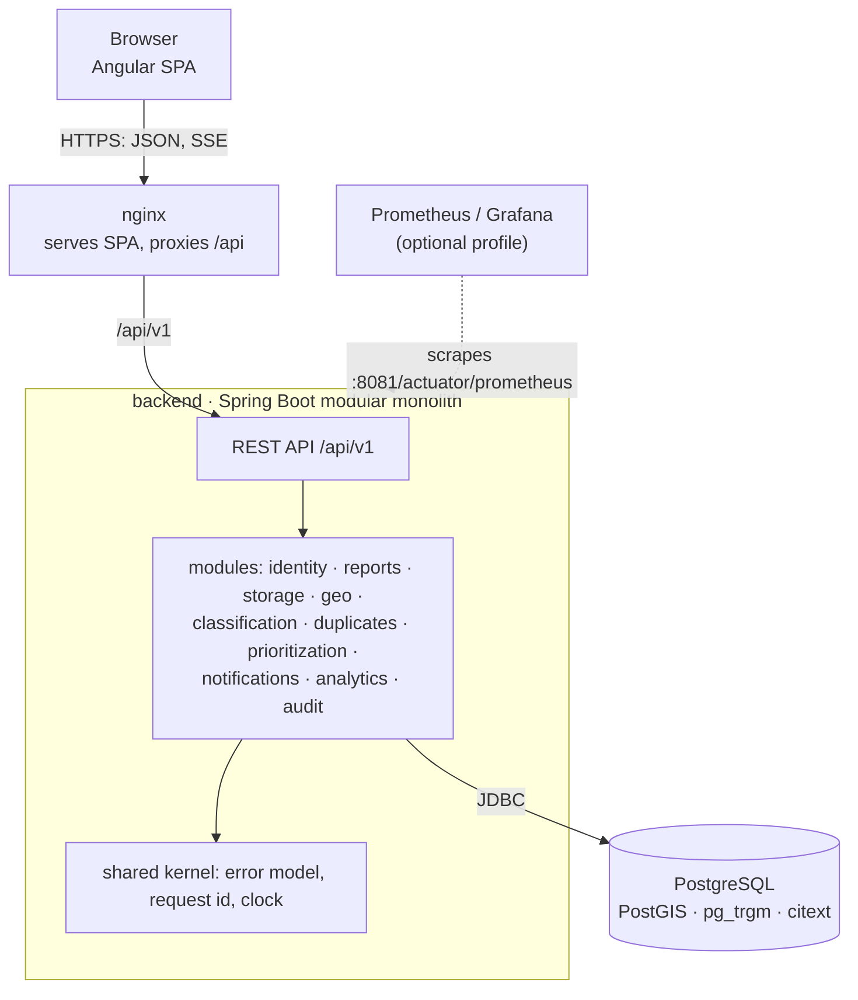

# Architecture overview

CivicPulse is one Spring Boot backend (a modular monolith), one Angular SPA
served by nginx, and PostgreSQL with PostGIS. The full design rationale is in
the ADRs; this page is the map.

## Runtime

Only the database is required for the backend to report ready. Mail, photo
storage and the optional LLM are adapters behind interfaces (added in later phases).

## Module map

| Module | Owns | Phase |
| --- | --- | --- |
| `shared` | error model, request id, clock, paging (open module) | 1 |
| `identity` | users, roles, teams, login, refresh tokens | 2 |
| `reports` | Report aggregate, lifecycle, timeline, comments, confirmations, assignments, photo metadata | 3 |
| `geo` | districts, critical sites, city boundary | 4 |
| `storage` | file storage port, upload validation, re-encoding | 7 |
| `duplicates` | candidate search, similarity scoring, review | 8 |
| `prioritization` | priority score, SLA clock, escalation job | 9 |
| `notifications` | in-app and email delivery, retries, SSE | 10 |
| `classification` | rule-based and LLM classifiers | 11 |
| `analytics` | dashboard aggregates, hotspots | 6 |
| `audit` | append-only audit log | 2 |

Modules are added when their phase starts; empty placeholder packages are not
created ahead of time. Boundaries are verified by `ModularityTests`
(see [ADR-001](../adr/001-modular-monolith.md)).

## Layering inside a module

| Package | Contains | Rule |
| --- | --- | --- |
| `api` | controllers, request/response DTOs | no business decisions; never exposes entities |
| `application` | use-case services, transactions, authorization checks | orchestrates; publishes events |
| `domain` | entities with behaviour, value objects, state machine, calculators | the only place business rules live |
| `infrastructure` | repositories, native queries, external adapters | implements ports defined by the domain/application |

## Cross-cutting behaviour

- **Request ids.** `RequestIdFilter` accepts a well-formed `X-Request-Id` or
  generates one, puts it in the logging context as `requestId`, and echoes it
  in the response. Error bodies carry the same value as `traceId`.
- **Errors.** `GlobalExceptionHandler` maps every failure to the uniform error
  model in [docs/api](../api/README.md). Unexpected exceptions are logged with
  the request id and returned as a generic 500.
- **Logs.** Structured JSON (ECS) in containers via Spring Boot's built-in
  structured logging; plain text when run directly for development.
- **Time.** A `java.time.Clock` bean is injected wherever time matters, so tests
  control time instead of sleeping.
