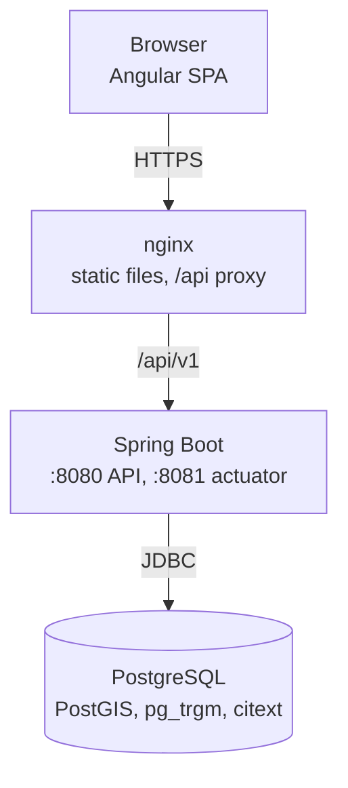

# Architecture

One Spring Boot backend (modular monolith), an Angular SPA served by nginx, and
PostgreSQL with PostGIS. Reasons are in the [ADRs](../adr/).

## Runtime

The backend is ready once the database answers. Mail, file storage and the
optional LLM will be adapters behind interfaces, so they can be down without
taking the app down.

## Modules

| Module | Responsibility |
| --- | --- |
| `shared` | error format, request ids, clock, security configuration, rate limiting (open module) |
| `identity` | users, roles, teams, login, refresh tokens |
| `reports` | reports and their lifecycle, timeline, comments, confirmations, assignments |
| `geo` | districts, critical sites, city boundary |
| `storage` | file storage and upload validation |
| `duplicates` | duplicate candidates and scoring |
| `prioritization` | priority score, SLA, escalation |
| `notifications` | in-app and email notifications, live updates |
| `classification` | rule-based and LLM classifiers |
| `analytics` | dashboard figures, hotspots |
| `audit` | audit log |

`shared`, `identity` and `audit` exist so far; the others are added as they are built.
`audit` listens to events published by `identity` and never calls it directly.
`ModularityTests` checks the boundaries ([ADR 001](../adr/001-modular-monolith.md)).

## Inside a module

| Package | Contents |
| --- | --- |
| `api` | controllers and DTOs, no business logic |
| `application` | use cases, transactions, authorization checks |
| `domain` | entities with behaviour, value objects, business rules |
| `infrastructure` | repositories, SQL, external adapters |

## Cross-cutting

- Request ids: `RequestIdFilter` reuses a valid `X-Request-Id` header or
  generates one, adds it to the log context and to the response. Error bodies
  return it as `traceId`.
- Errors: `GlobalExceptionHandler` and `ApiErrorController` map every failure to
  the format in [docs/api](../api/README.md).
- Logs: JSON (ECS) in Docker, plain text when run locally.
- Time: a `Clock` bean is injected wherever time matters, so tests can control it.
