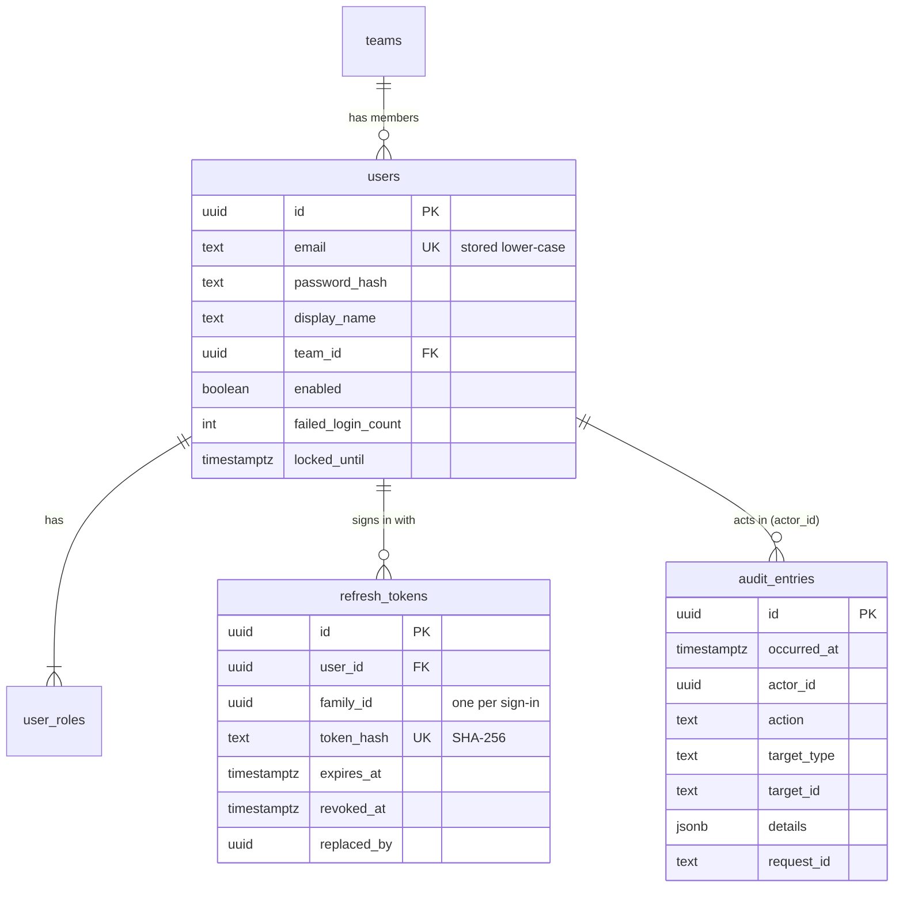
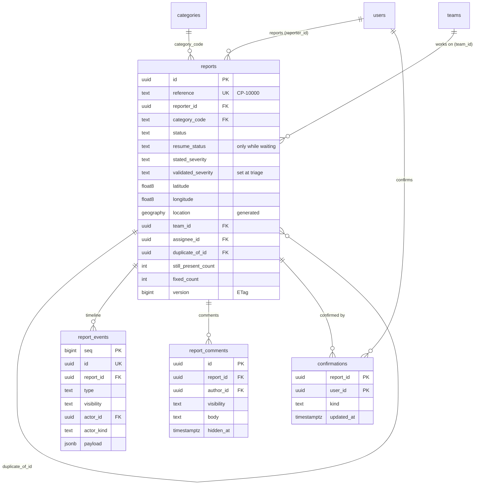

# Database

PostgreSQL 17 with PostGIS, pg_trgm and citext ([ADR 002](../adr/002-postgresql-postgis.md)).

## Migrations

- Location: `backend/src/main/resources/db/migration`
- Naming: `V<n>__<description>.sql`
- Merged migrations are never edited; add a new one instead.
- Hibernate only validates the schema (`ddl-auto=validate`).
- `FlywayMigrationIT` migrates an empty database on every build.

| Version | Change |
| --- | --- |
| V1 | enable `postgis`, `pg_trgm`, `citext` |
| V2 | `teams`, `users`, `user_roles`, `refresh_tokens` |
| V3 | `audit_entries` and the `reject_row_change()` trigger function |
| V4 | `categories`, `reports`, `report_events`, `report_comments`, `confirmations` |

## Tables

- Emails are saved in lower case (`CHECK (email = lower(email))`), so the unique
  key works case-insensitively.
- `user_roles.role` must be one of the four roles.
- `audit_entries` is append-only (trigger). `actor_id` has no foreign key so
  audit rows never block anything else.
- Refresh tokens with the same `family_id` come from the same login.

### Reports

- The lifecycle rules are in code ([ADR 004](../adr/004-report-lifecycle.md));
  the database adds checks that hold in every status: `resume_status` is set
  only while waiting, `DUPLICATE` always has `duplicate_of_id`, `ASSIGNED` and
  `IN_PROGRESS` always have a team.
- `location` is generated from `latitude` and `longitude`, so JPA only maps
  plain numbers. The spatial index comes with the geo queries.
- `report_events` is append-only like `audit_entries`. `seq` keeps the order of
  entries written in the same millisecond.
- `still_present_count` and `fixed_count` are only written by an SQL recount
  after a confirmation changes; the JPA mapping is read-only for them.
- `version` is incremented by Hibernate on every update and used as the ETag.
- References come from the sequence `report_number_seq`, starting at 10000.
- Categories are seeded by the migration. Their labels are translated in the
  frontend.

## Conventions

- Primary keys: UUID v7 generated in the application (`Ids.newId()`), which
  are time-ordered and index-friendly. Lookup tables with a natural code use
  the code.
- Timestamps: `timestamptz`, UTC.
- Enumerations: `text` with a `CHECK` constraint.
- Locations: `geography(Point, 4326)`, generated from latitude/longitude where
  the application writes them.
- Every foreign key column is indexed.
