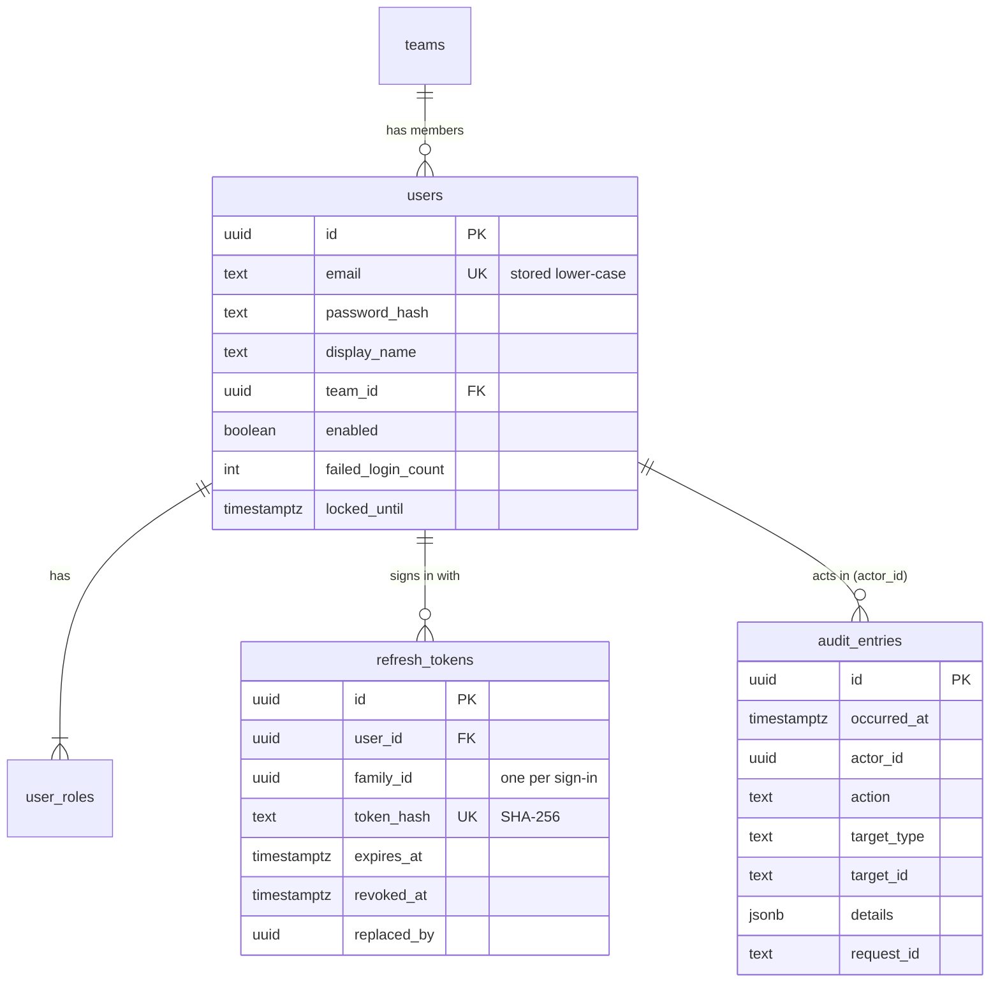

# Database

PostgreSQL 17 with PostGIS, pg_trgm and citext ([ADR 002](../adr/002-postgresql-postgis.md)).

## Migrations

- Location: `backend/src/main/resources/db/migration`
- Naming: `V<n>__<description>.sql`
- Merged migrations are never edited; add a new one instead.
- Hibernate only validates the schema (`ddl-auto=validate`).
- `FlywayMigrationIT` migrates an empty database on every build.

| Version | Change |
| --- | --- |
| V1 | enable `postgis`, `pg_trgm`, `citext` |
| V2 | `teams`, `users`, `user_roles`, `refresh_tokens` |
| V3 | `audit_entries` and the `reject_row_change()` trigger function |

## Tables

- Emails are saved in lower case (`CHECK (email = lower(email))`), so the unique
  key works case-insensitively.
- `user_roles.role` must be one of the four roles.
- `audit_entries` is append-only (trigger). `actor_id` has no foreign key so
  audit rows never block anything else.
- Refresh tokens with the same `family_id` come from the same login.

## Conventions

- Primary keys: UUID v7 generated in the application (`Ids.newId()`), which
  are time-ordered and index-friendly. Lookup tables with a natural code use
  the code.
- Timestamps: `timestamptz`, UTC.
- Enumerations: `text` with a `CHECK` constraint.
- Locations: `geography(Point, 4326)`.
- Every foreign key column is indexed.
